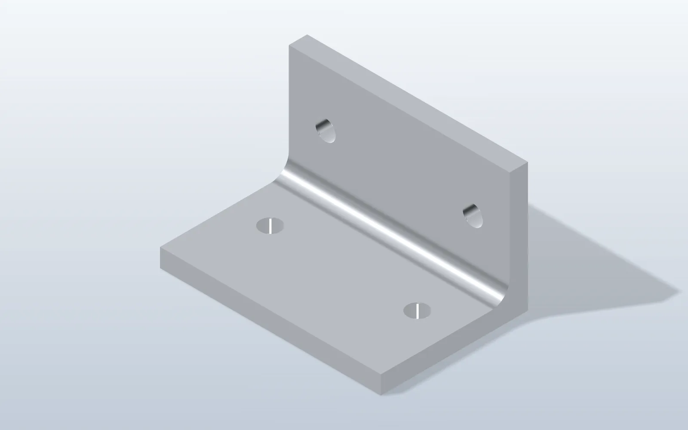
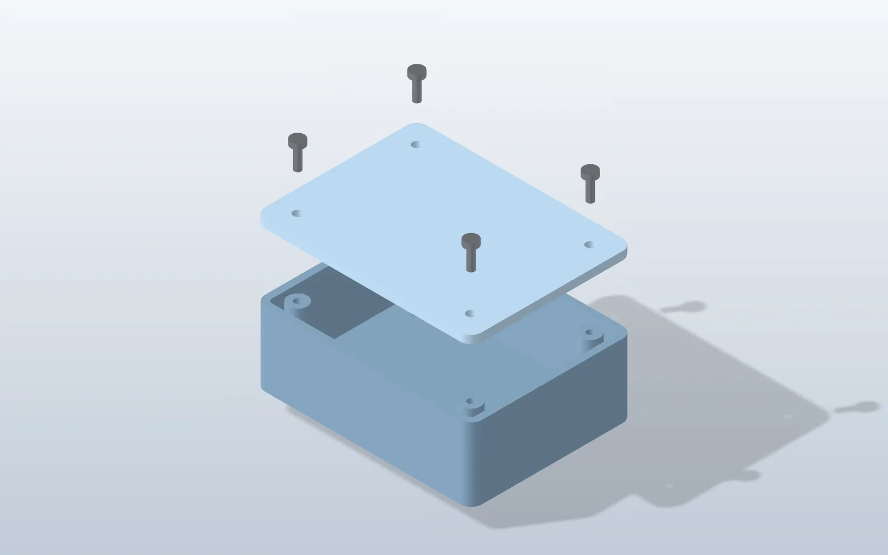
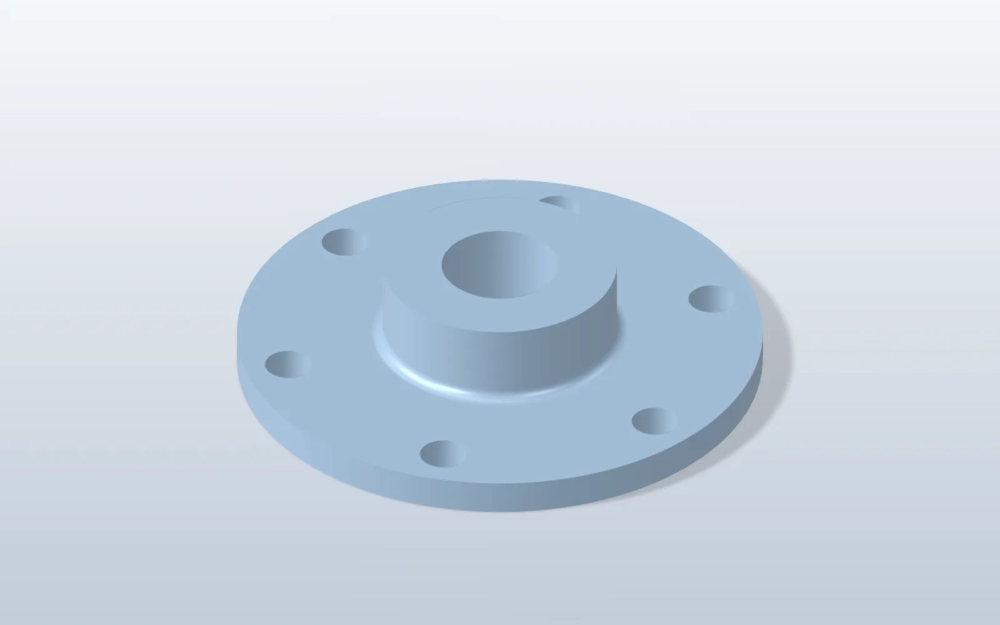
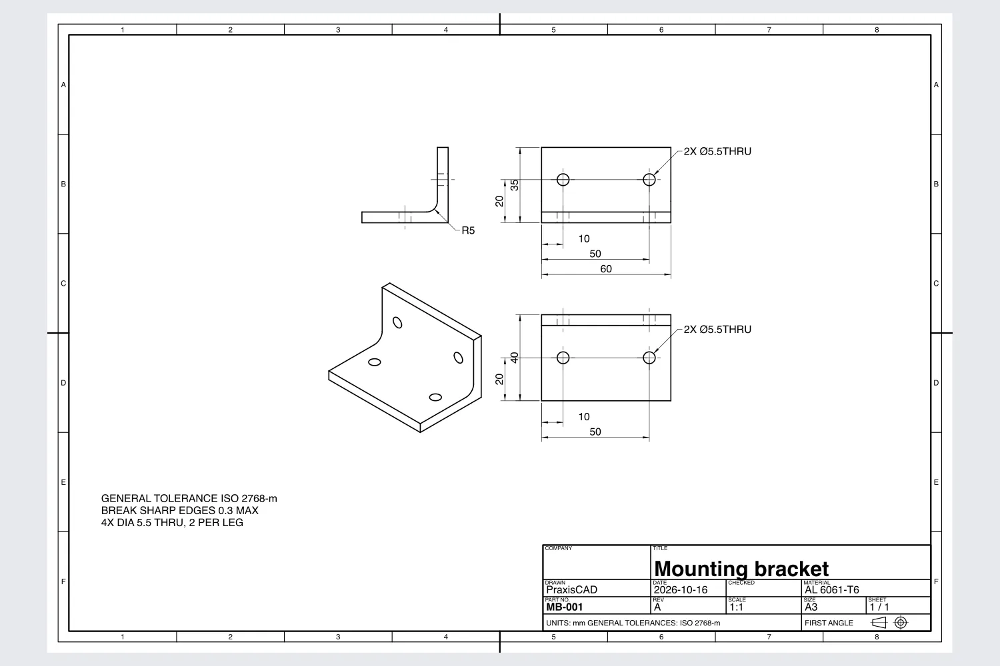
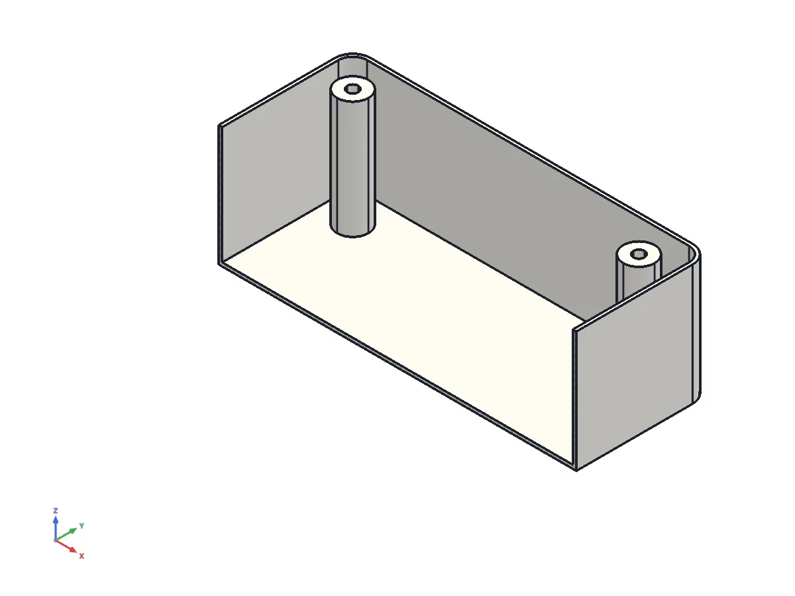
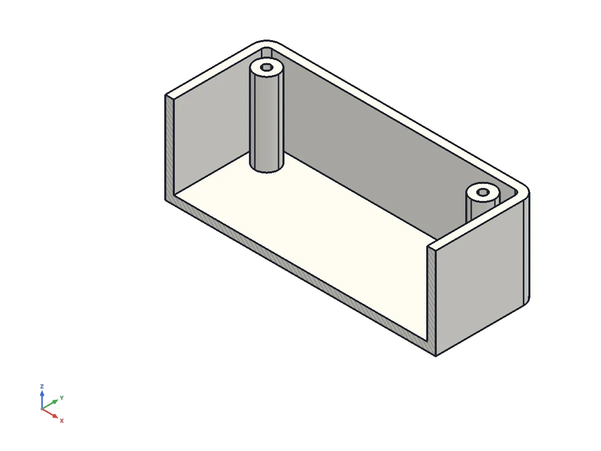
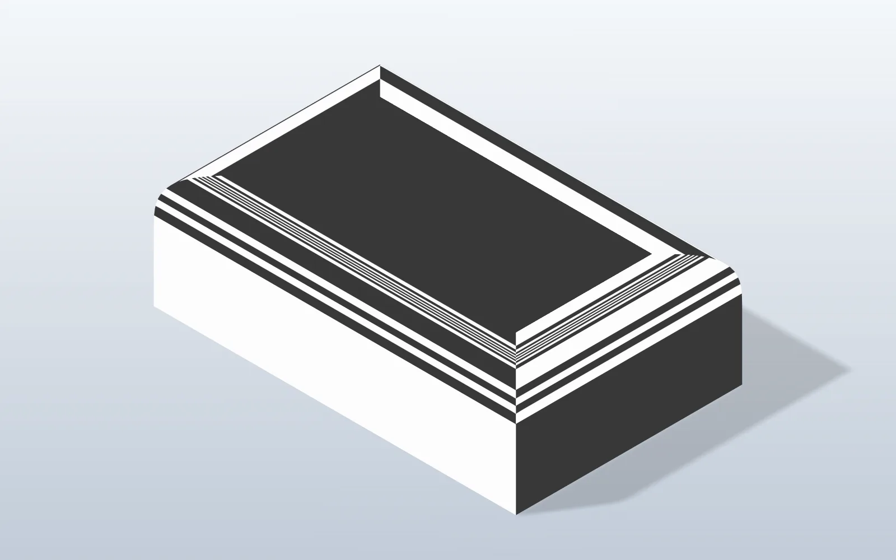
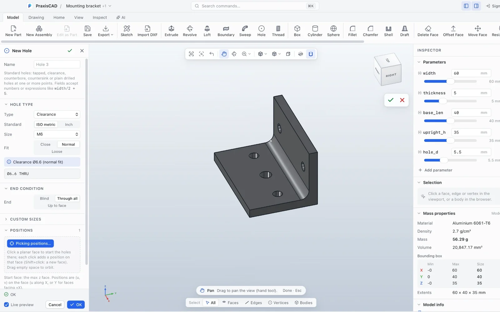

# PraxisCAD: AI CAD, text-to-CAD and image-to-CAD over MCP (local and private)

**MCP CAD server skill for any AI client, cloud or local LLM (Ollama, LM Studio).** PraxisCAD is a
local-first, offline desktop CAD app (macOS and Windows): your designs never leave your computer.
Parametric modeling, STEP import/export, STL/3MF for 3D printing, 2D drawings, assemblies and
manufacturability checks, all driven by plain-language chat. Support: support@praxiscad.com.

Keywords: CAD, text to CAD, MCP CAD, AI CAD, local LLM CAD, offline, private, STEP, 3D printing, parametric.

**Describe a part in plain words, or show your AI a sketch or photo, and get a real, editable
parametric 3D CAD model** — with STEP/STL export, 2D drawings, assemblies and manufacturability
checks. This is the open skill and instruction set for **PraxisCAD**, an AI-native desktop CAD app
for macOS and Windows with a built-in MCP (Model Context Protocol) server.

> Example prompts: *"Make a 60 × 40 × 5 mm aluminium mounting plate with four M4 clearance holes
> 6 mm from each corner."* · *"Here is a photo of my broken bracket — model a replacement I can
> 3D print."* · *"Open this STEP file, enlarge the bore to 12 mm and export it again."*

Design, edit and check CAD parts by chatting with **any AI assistant** that supports MCP —
Claude, ChatGPT/Codex, Gemini, Cursor, VS Code Copilot, Windsurf, LM Studio with local models,
and more. PraxisCAD is a desktop CAD app with a built-in MCP server; this repository teaches your
AI assistant how to use it well:
- build **parametric parts** from a description, or from a photo or drawing traced as a
  calibrated **reference image**, with named dimensions you can change later;
- edit existing parts through their parameters, with a **rollback bar** to insert features
  anywhere in the history;
- add **standard holes** with the hole wizard — tapped, clearance, counterbored, countersunk and
  counterdrilled, ISO metric and inch sizes — and **cosmetic or modeled threads**;
- sketch with **splines, ellipses, slots, text and conics**, edit sketches with trim, extend,
  offset, fillet, mirror and patterns, project model edges, **import DXF** outlines and
  **export any sketch as DXF** for laser or waterjet cutting;
- assign **materials** from a library of 22 engineering materials for real mass and BOM weights,
  set **colours and finishes** per part, body or face, and make **product renders** (studio,
  outdoor or warehouse lighting, transparent background);
- **edit imported STEP files**: resize holes, remove fillets and chamfers, push/pull and move
  faces, add new features, export STEP again;
- put parts together in **assemblies** with mates (including gear, rack-and-pinion, cam, limit,
  symmetric and width mates), mate suggestions, rigid **sub-assemblies**, DOF diagnostics,
  **motion previews** (drag a component and see what moves), a top-level, indented or flat bill
  of materials and an interference check;
- make dimensioned **2D drawings** of parts, assemblies and STEP models: standard, detail, section
  and exploded views, ordinate/baseline/chain dimensions, **tolerances and ISO fits**, **GD&T**
  (datums, feature control frames) and surface finish, standard **hole callouts** and thread
  lines, **BOM tables and balloons**, multiple sheets and a title block, exported as PDF, DXF or
  SVG;
- run a **design check** for CNC, 3D printing (FDM/SLA), injection molding or sheet metal and
  fix the issues it finds;
- verify everything with exact mass properties, measurements and screenshots from any angle
  (custom directions, perspective, sections) of **one model at a time**, or of chosen bodies
  only (hide the lid to look inside), without touching your other open models, and **point at
  faces** by highlighting them in your PraxisCAD window;
- save `.pcad` / `.pcasm` / `.pcdrw`, or export STEP, STL, 3MF, OBJ or a sketch as DXF.

> Status: preview (v0.12). File extensions .pcad/.pcasm/.pcdrw. Adds install guidance when PraxisCAD is missing, loft end conditions (tangent/curvature), boundary solids through sections and guide curves, curvature-continuous fillets, and surface analysis to verify G1/G2 seams. Parametric modeling (sketch, extrude, revolve, holes, fillets and
> chamfers including mixed convex/concave corners, patterns, mirror, loft, sweep, shell, draft),
> hole wizard and threads, sketch tools and DXF import/export, materials, appearances and
> product renders, reference images, imported-STEP editing (mesh-only bodies kept), assemblies
> with sub-assemblies, motion mates, mate suggestions and motion previews, 2D drawings of parts
> and assemblies with tolerances, GD&T, hole callouts, BOM and collision-free balloons, design
> check with feature-aware hole sizes, viewing (per-model renders, isolated bodies, custom
> angles, perspective, sections), selection highlighting, rebuild and inspection, and safe
> handling of long operations (request ids, operation status, no blind retries). Matches PraxisCAD 0.4.0.

The PraxisCAD MCP server already sends core instructions to every client, so this repository is
optional — it makes results better (design rules, workflows, worked examples).

## Beta and first launch

> **Beta.** PraxisCAD is in beta: expect rough edges, and please report anything odd.

### First launch (the app is not code-signed yet)
PraxisCAD is not yet signed with an Apple Developer ID, so every Mac shows a one-time warning.
The warning is about the missing signature, not about anything found in the app; signed builds are coming soon.

**macOS**
1. Open the downloaded `.dmg` and drag **PraxisCAD** to **Applications**.
2. Open PraxisCAD. macOS says it could not verify the app. Click **Done** (not Move to Bin).
3. Open **System Settings → Privacy & Security**, scroll down, click **Open Anyway** next to PraxisCAD, and confirm.
   You only need to do this once.

**Windows:** if SmartScreen appears, click **More info → Run anyway**.

## What your AI can do with PraxisCAD

Real results from plain-language requests to an MCP-capable AI client:

<table>
<tr><td width="50%" valign="top"> <b>Ask:</b> "Make an L-shaped mounting bracket from 6061 aluminium, 60 mm wide, 5 mm thick, two 5.5 mm holes in each leg, 5 mm radius on the inside bend." <b>The AI:</b> builds a parametric bracket with named dimensions.</td><td width="50%" valign="top"> <b>Ask:</b> "Build an 80 x 60 x 30 mm enclosure with 2.5 mm walls and four screw bosses, add a lid, check interference, show it exploded." <b>The AI:</b> models the parts, assembles them with mates and shows an exploded view.</td></tr>
<tr><td width="50%" valign="top"> <b>Ask:</b> "Make two spur gears, 20 and 40 teeth, 60 mm apart, linked so the big one turns at the right ratio." <b>The AI:</b> creates both gears (teeth are simplified) and links them with a gear mate.</td><td width="50%" valign="top"> <b>Ask:</b> "Open this STEP file, make it editable and make the six bolt holes 8 mm instead of 6 mm. Export it again." <b>The AI:</b> imports the STEP, lists its features, enlarges the holes and re-exports.</td></tr>
<tr><td width="50%" valign="top"> <b>Ask:</b> "Make an A3 drawing of the bracket with front, top, right and isometric views, dimensions and a title block. Export a PDF." <b>The AI:</b> lays out the views, adds dimensions and a title block, exports PDF.</td><td width="50%" valign="top"> <b>Ask:</b> "Check this enclosure for injection moulding and suggest a change if needed." (before) <b>The AI:</b> runs the design check and flags the 0.8 mm walls (limit 1.2 mm).</td></tr>
<tr><td width="50%" valign="top"> <b>Ask:</b> Same request, after the fix. <b>The AI:</b> with your OK, thickens the wall to 2.5 mm and re-checks.</td><td width="50%" valign="top"> <b>Ask:</b> "Make an 80 x 50 x 25 mm block with a smooth 10 mm blend on the top edges and show me zebra stripes." <b>The AI:</b> applies a curvature-continuous fillet and shows zebra stripes to check it.</td></tr>
<tr><td width="50%" valign="top"> <b>Ask:</b> No prompt needed. <b>The AI:</b> You can take over anytime: change a value yourself and the model rebuilds.</td><td width="50%"></td></tr>
</table>

## What's here

| Path | For |
|---|---|
| `instructions/AGENTS.md` | **Any AI client**: use as Cursor rules, Codex `AGENTS.md`, Gemini `GEMINI.md`, VS Code Copilot instructions, or a system prompt |
| `skills/praxiscad/` | The same guidance in the open **Agent Skills** format (`SKILL.md` + references + examples), e.g. for Claude |
| `skills/praxiscad/references/` | Modeling operations, holes and threads, sketch tools and DXF import/export, materials and appearance, image-to-CAD and reference images, editing STEP files, assemblies, drawings, design check, design rules (DFM), views & conventions, troubleshooting |
| `skills/praxiscad/examples/` | Worked examples: L-bracket, flange, enclosure, inspecting a STEP file (more in each reference: M5 tapped and M6 counterbored holes, engraved text, DXF outline to part and back to DXF, anodised aluminium product render, bracket-on-plate assembly, gear pair, L-bracket drawing, toleranced flange drawing with GD&T, assembly drawing with BOM and balloons, STEP hole resize, CNC design-check fix, photo tracing) |
| `install/README.md` | Install PraxisCAD and connect your AI client |

## Quick start
1. Install and open PraxisCAD (macOS or Windows) — see [install/README.md](install/README.md). Latest builds: [macOS](https://praxiscad.com/get/macos), [Windows](https://praxiscad.com/get/windows).
2. In PraxisCAD choose **AI → Connect AI assistant** and click Connect next to your client
   (or add the `praxiscad` MCP server to your client's config by hand).
3. Optional — add the instructions:
   - **Cursor:** copy `instructions/AGENTS.md` to `.cursor/rules/praxiscad.mdc` in your project.
   - **OpenAI Codex CLI:** put it in your project's `AGENTS.md`.
   - **Gemini CLI:** put it in `GEMINI.md`.
   - **VS Code Copilot:** `.github/copilot-instructions.md`.
   - **Claude Code (plugin):** `/plugin marketplace add praxiscad/praxiscad-skill`, then `/plugin install praxiscad@praxiscad` (or copy `skills/praxiscad` to `~/.claude/skills/praxiscad`).
   - **Claude apps / ChatGPT (workplace plans):** download `praxiscad-skill.zip` from the [latest release](https://github.com/praxiscad/praxiscad-skill/releases/latest) and upload it as a skill. ChatGPT web/desktop cannot reach the local PraxisCAD MCP server yet.
   - **OpenAI Codex:** MCP server in `~/.codex/config.toml` (`[mcp_servers.praxiscad]`, see [install/README.md](install/README.md#openai-codex)); skills go in `~/.agents/skills/praxiscad`.
   - **Other clients:** paste `instructions/AGENTS.md` into the system prompt.
4. Ask your AI: *"In PraxisCAD, make a 100 × 60 × 6 mm aluminium plate with four M5 holes 10 mm from the corners."*

Works best with models that accept images (they can look at PraxisCAD's renders); text-only models
still get every number (bounding box, volume, mass).

## Example prompts

**Text-to-CAD**
- "Make an L-bracket from 5 mm aluminium: 60 mm wide, legs 50 and 40 mm, two M5 holes per leg."
- "Design a flange: OD 140, 14 mm thick, Ø70 × 20 hub, 50 mm bore, 6 × M10 on a 100 mm PCD."
- "I need a 3D-printed box for an 80 × 50 mm PCB, 2 mm walls, M3 lid screws and a USB-C cut-out."
- "Model a shaft: Ø20 for 40 mm, then Ø15 for 25 mm, with a 1 mm chamfer at both ends."

**Holes and threads**
- "Add four M5 tapped holes, 10 deep, 8 mm in from the corners."
- "Put counterbored holes for M6 socket head screws in each corner of the plate."
- "Make those clearance holes a close fit, and switch them to M8."
- "Thread the end of the shaft M10 for 20 mm — a real thread, I'm going to 3D print it."

**Sketches and DXF**
- "Engrave 'LOT 42' on the top face, 5 mm high and 0.5 mm deep."
- "Import ~/Downloads/gasket.dxf — only the OUTLINE layer — and extrude it 3 mm."
- "Make an elliptical plate 80 × 50 with a 30 mm slot in the middle."
- "Offset the outline 2 mm outward and round its corners R3."
- "Export that sketch as a DXF for the laser cutter."

**Materials and renders**
- "Make it anodised blue aluminium and render a product shot on a transparent background."
- "What does it weigh in stainless 316? And in PEEK?"
- "Make the feet black rubber and the top face polished."

**Image-to-CAD**
- "Here's a photo of a bracket next to a ruler. Rebuild it in PraxisCAD as a parametric part."
- "Put ~/Pictures/bracket-front.jpg on the front plane, the base is 100 mm wide, and trace it."
- "Recreate this drawing (attached) in PraxisCAD. Ask me if any dimension is unclear."

**Editing STEP files**
- "Open ~/Downloads/mount.step, make all the Ø6 holes Ø6.6 and remove the fillets, then export a new STEP."
- "Make the top plate of this STEP part 2 mm thicker and add two M5 tapped holes on it."
- "What holes does this STEP file have? List them by size."

**Assemblies**
- "Bolt the bracket to the plate with an M6 bolt and check nothing collides."
- "Make an assembly of the enclosure and its lid, and give me a BOM with masses in PETG."
- "Why can the shaft still move? Fix the mates so only rotation is free."
- "Mesh a 20-tooth pinion with a 40-tooth gear, module 2, and turn the pinion 30°."
- "Limit the slider's travel to 10–60 mm."
- "Which mate should I use between the shaft and this bore?"
- "Turn the crank a quarter turn and tell me how far the slider moves — don't change anything."
- "Use the saved bracket-on-plate assembly twice on this base and give me an indented BOM and a flat parts list."

**2D drawings**
- "Make an A4 drawing of the bracket with material AL 6061-T6 and tolerance ISO 2768-m, then export a PDF and a DXF."
- "Add a section view through the holes and a detail view of the bend."
- "Switch the drawing to third-angle projection on A3."
- "Make the bore an H7 fit, the thickness ±0.1, and add a position tolerance for the bolt holes to datums A and B."
- "Dimension the hole positions as ordinates from the left edge."
- "Make an assembly drawing with a parts list and balloons, and an exploded view on a second sheet."
- "Put the balloons on the right of the exploded view, 4 mm apart."

**Design check**
- "Can this be machined on a 3-axis mill with a 6 mm cutter? Fix what can't."
- "Is it ready to print in PETG? Check overhangs with Z up and upside down."
- "Check the housing for injection molding and add the draft it needs."

**Parametric edits**
- "Make it 20 mm wider and switch the holes to M6."
- "Add a 2 mm fillet to the top edges, then show me the iso view."
- "Change the bolt pattern to 8 holes and tell me the new weight in steel."
- "Roll back to the base plate and add a rib before the fillets."
- "Undo that last change."

**Checking and exporting**
- "What does this part weigh in PETG? Is any wall thinner than 1.2 mm?"
- "Save it as ~/parts/bracket.pcad and export a STEP for the machinist."
- "Export a 3MF for my slicer."
- "Open ~/Downloads/part.step and tell me its size and volume, in inches too."
- "I clicked a face in PraxisCAD. What is its area?"
- "Which face is too thin? Highlight it for me."
- "Show me the underside in perspective, and turn on a section through the bore."
- "Render the housing without its lid so I can see the bosses — leave my other parts open."
- "I re-exported the linked STEP file — rebuild the part."

## FAQ

**Is this text-to-CAD?** Yes. Your AI assistant turns a written description into a parametric
model in PraxisCAD, with named dimensions you can change later, not a one-off mesh.

**Is this image-to-CAD?** Your AI assistant reads a photo, sketch or drawing and builds the model
in PraxisCAD; you can also trace a calibrated reference image. Accuracy depends on the dimensions you
give.

**Does it work with a local LLM and offline?** Yes. PraxisCAD runs on your computer and does not
call any AI service itself. Connect a local runtime that supports MCP tools (for example Ollama or
LM Studio through an MCP-capable client) and nothing about your design leaves your machine. Results
depend on the model; larger tool-calling models do better. PraxisCAD may check for app updates and
the optional account sign-in uses the network; designs are never uploaded.

**Which AI assistants work?** Any assistant or agent that supports MCP tools. The skill is
model-agnostic, and you use your own AI subscription; PraxisCAD does not charge for AI usage.

**What file formats?** STEP import/export, STL, 3MF and OBJ export, DXF import/export, and PDF, DXF
or SVG drawings.

## Support and bug reports

Email **support@praxiscad.com**. If a PraxisCAD tool misbehaves, your AI client can offer to draft
a bug report with the `prepare_bug_report` tool (newer app versions): it opens your mail app with a
draft addressed to support@praxiscad.com, and you review and send it. Nothing is sent automatically
and model or file details are only included if you agree.
